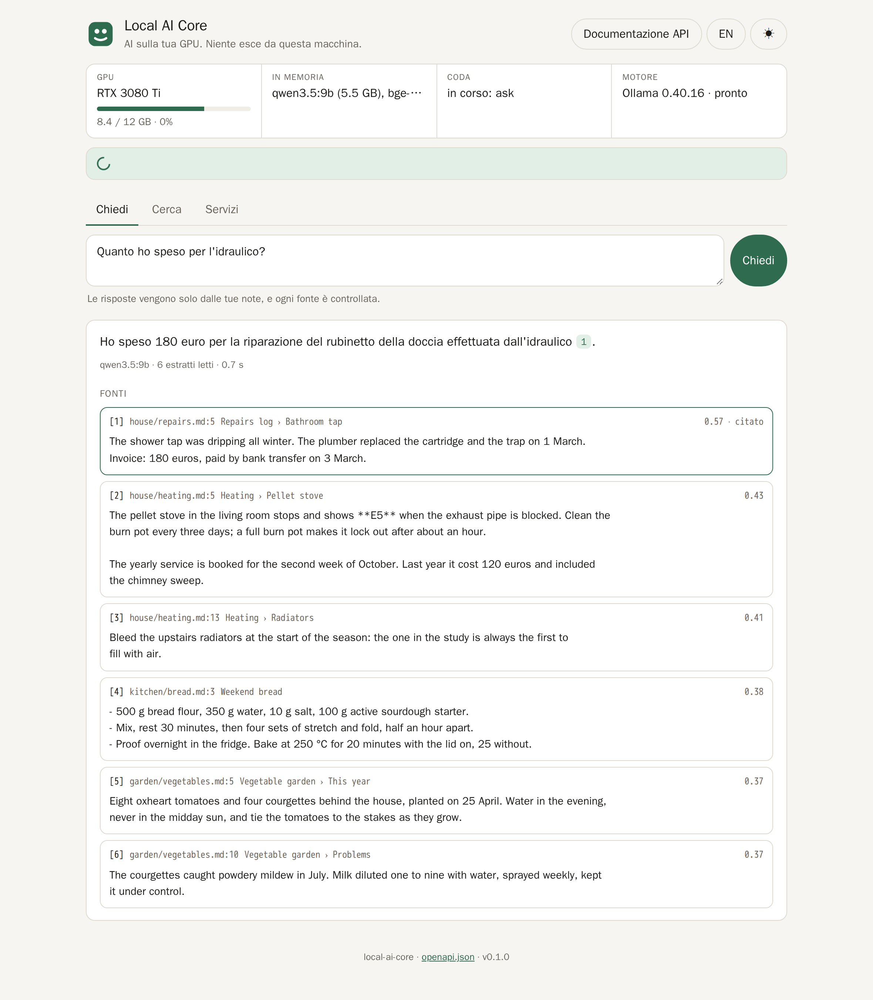

# 🧠 Local AI Core

**Servizi di AI locale sulla tua GPU, dietro un'unica API e un'unica pagina web.** Cerca nelle tue note
per significato e ottieni risposte che citano la nota da cui vengono, con ogni citazione controllata.
Niente esce dal tuo computer.



## Avvio in tre comandi

```bash
git clone https://github.com/manzolo/local-ai-core.git && cd local-ai-core
docker compose up -d
# apri http://localhost:8090
```

Servono Docker e il NVIDIA Container Toolkit, nient'altro. Il primo avvio scarica i modelli (circa 8 GB).
La guida passo passo è il **[Quick start](docs/quick-start.md)** (in inglese).

L'interfaccia è in inglese e in italiano: segue la lingua del browser, e il pulsante in alto a destra la
cambia. Le risposte sono nella lingua della domanda.

La documentazione completa, in inglese, parte dall'indice del [README](README.md).
