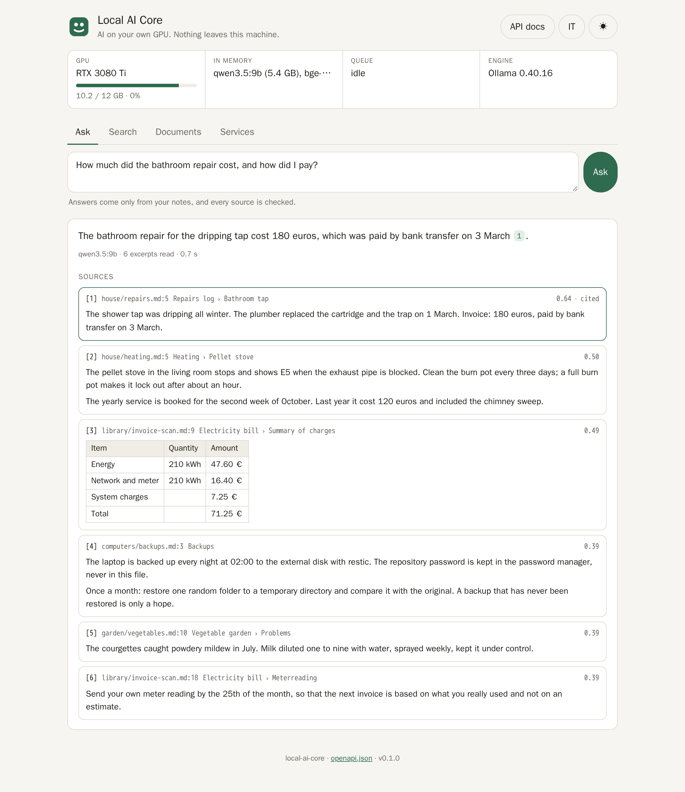
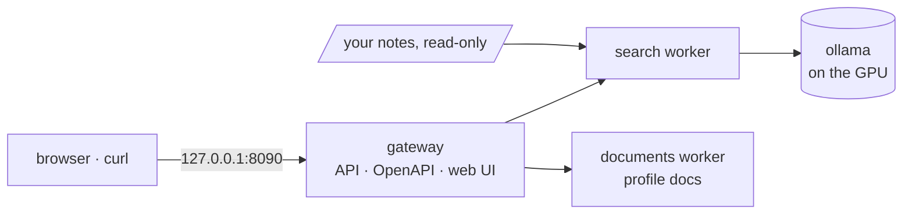

# 🧠 Local AI Core

**Local AI services on your own GPU, behind one API and one web page.** Search your notes by meaning, turn
PDFs and scans into Markdown, and get answers that cite the note or document they come from, with every
citation checked. More services (transcription, images, voice) join as compose profiles. Nothing leaves
your machine.

[](https://github.com/manzolo/local-ai-core/actions/workflows/ci.yml)


[](https://github.com/manzolo/local-ai-lab)



## Start in three commands

```bash
git clone https://github.com/manzolo/local-ai-core.git && cd local-ai-core
docker compose up -d
# open http://localhost:8090
```

You need Docker and the NVIDIA Container Toolkit on the host. Nothing else. The first start downloads
the models (about 8 GB). **→ [Quick start](docs/quick-start.md)** covers everything, from checking the
GPU to searching your own notes.

## Services

| Service | What it does | Model | VRAM | License | Profile |
|---|---|---|---|---|---|
| [Search](docs/services/search-ask.md) | find notes by meaning, not by exact words | bge-m3 | ~2 GB | MIT | default |
| [Ask](docs/services/search-ask.md) | answers only from your notes, every citation checked | qwen3.5:9b | ~8 GB | Apache-2.0 | default |
| [Documents](docs/services/documents.md) | PDF (scanned too), images, Office, HTML → Markdown; into the library to ask about them | Docling 2.151.1 | ~3 GB | MIT · Apache-2.0 · CDLA-P-2.0 | `docs` |

Turn a profile on with `docker compose --profile docs up -d`. The roadmap adds transcription with
speakers (Whisper), images (ComfyUI), handwriting (qwen3-vl) and voice (XTTS-v2, non-commercial), each
in its own profile.

## Documentation

| Section | Read it to… |
|---|---|
| **[Quick start](docs/quick-start.md)** | go from zero to the first answer, step by step |
| [Web interface](docs/web-ui.md) | find your way around the page |
| [API guide](docs/api.md) | call the API: questions, jobs, event streams, `curl` examples |
| [Configuration](docs/configuration.md) | change port, models, notes folder, API key |
| [Architecture](docs/architecture.md) | see how gateway, workers and Ollama fit together |
| [Join the local-ai-lab family](docs/family.md) | share Ollama and `local-ai-net` with the other projects |
| [Testing](docs/testing.md) | understand the tests, the mutations and the GPU test |
| [Licenses](docs/licenses.md) | check the license of the code and of each model |
| [Troubleshooting](docs/troubleshooting.md) | fix the usual problems |

Services: [Search and Ask](docs/services/search-ask.md) · [Documents](docs/services/documents.md).

## At a glance



- **One API** at `/v1`, described at `/docs` and `/openapi.json`; long work runs as jobs you can follow
  live.
- **One GPU queue**: one heavy job at a time, so the services share a 12 GB card without running out.
- **Safe by default**: listens on `127.0.0.1`, optional API key, upload limit, read-only notes, no telemetry.
- **Tested like it matters**: known data → expected answers, plus errors put in on purpose that the tests
  must catch, on CPU in CI and on the real GPU with `make collaudo`.

---

*Part of [local-ai-lab](https://github.com/manzolo/local-ai-lab), the family of manzolo's self-hosted AI
projects.* · Italiano: [README.it.md](README.it.md)
