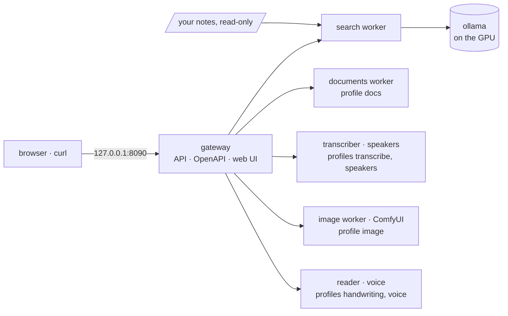

# 🧠 Local AI Core

**Local AI services on your own GPU, behind one API and one web page.** Search your notes by meaning, turn
PDFs and scans into Markdown, get answers that cite the note or document they come from (every citation
checked), transcribe audio and video with who said what, make, upscale and cut out images, read handwritten notes
and turn text into speech. Each service is a compose profile you turn on. Nothing leaves your machine.

[](https://github.com/manzolo/local-ai-core/actions/workflows/ci.yml)


[](https://github.com/manzolo/local-ai-lab)


## Start in three commands

```bash
git clone https://github.com/manzolo/local-ai-core.git && cd local-ai-core
docker compose up -d
# open http://localhost:8090
```

You need Docker and the NVIDIA Container Toolkit on the host. Nothing else. The first start downloads
the models (about 8 GB). **→ [Quick start](docs/quick-start.md)** covers everything, from checking the
GPU to searching your own notes.

## Services

| Service | What it does | Model | VRAM | License | Profile |
|---|---|---|---|---|---|
| [Search](docs/services/search-ask.md) | find notes by meaning, not by exact words | bge-m3 | ~2 GB | MIT | default |
| [Ask](docs/services/search-ask.md) | answers only from your notes, every citation checked | qwen3.5:9b | ~8 GB | Apache-2.0 | default |
| [Documents](docs/services/documents.md) | PDF (scanned too), images, Office, HTML → Markdown; into the library to ask about them | Docling 2.151.1 | ~3 GB | MIT · Apache-2.0 · CDLA-P-2.0 | `docs` |
| [Transcribe](docs/services/transcribe.md) | audio and video → text, SRT, WebVTT; check against an expected text | faster-whisper large-v3 | ~5 GB | MIT | `transcribe` |
| [Speakers](docs/services/transcribe.md) | who said what in a transcript | SpeechBrain ECAPA | ~1 GB | Apache-2.0 | `speakers` |
| [Images](docs/services/images.md) | text → image, upscale ×2/×4, cut out | SDXL + Lightning, RealESRGAN, BiRefNet (ComfyUI) | ~8 GB | OpenRAIL++-M (use restrictions) · BSD-3 · MIT | `image` |
| [Handwriting](docs/services/handwriting.md) | photos of handwritten notes → text | qwen3-vl:8b-instruct | ~7 GB | Apache-2.0 | `handwriting` |
| [Voice](docs/services/voice.md) | text → speech, long texts, listened to again | XTTS-v2 | ~3 GB | **non-commercial only** (CPML), you accept it | `voice` |

Turn profiles on with `docker compose --profile docs --profile transcribe --profile speakers --profile image
--profile handwriting up -d` (or `COMPOSE_PROFILES=…` in `.env`), or add `--profile control` and build, start
and stop them from the web page. The GPU is shared: before each job the
gateway frees what the others hold. **Voice** is for non-commercial use only and stays off until you accept
its license (`XTTS_ACCEPT_CPML=yes`).

## Documentation

| Section | Read it to… |
|---|---|
| **[Quick start](docs/quick-start.md)** | go from zero to the first answer, step by step |
| [Web interface](docs/web-ui.md) | find your way around the page |
| [API guide](docs/api.md) | call the API: questions, jobs, event streams, `curl` examples |
| [Configuration](docs/configuration.md) | change port, models, notes folder, API key |
| [Architecture](docs/architecture.md) | see how gateway, workers and Ollama fit together |
| [Join the local-ai-lab family](docs/family.md) | share Ollama and `local-ai-net` with the other projects |
| [Testing](docs/testing.md) | understand the tests, the mutations and the GPU test |
| [Licenses](docs/licenses.md) | check the license of the code, of each model and of every package |
| [Troubleshooting](docs/troubleshooting.md) | fix the usual problems |

Services: [Search and Ask](docs/services/search-ask.md) · [Documents](docs/services/documents.md) ·
[Transcribe and speakers](docs/services/transcribe.md) · [Images](docs/services/images.md) ·
[Handwriting](docs/services/handwriting.md) · [Voice](docs/services/voice.md).

## At a glance



- **One API** at `/v1`, described at `/docs` and `/openapi.json`; long work runs as jobs you can follow
  live.
- **One GPU queue that makes room**: one heavy job at a time, and before each one the gateway frees the
  VRAM the others hold, so every service fits on one 12 GB card.
- **Safe by default**: listens on `127.0.0.1`, optional API key, upload limit, read-only notes, no telemetry.
- **Tested like it matters**: known data → expected answers, plus errors put in on purpose that the tests
  must catch, on CPU in CI and on the real GPU with `make collaudo`.

---

*Part of [local-ai-lab](https://github.com/manzolo/local-ai-lab), the family of manzolo's self-hosted AI
projects.* · Italiano: [README.it.md](README.it.md)
