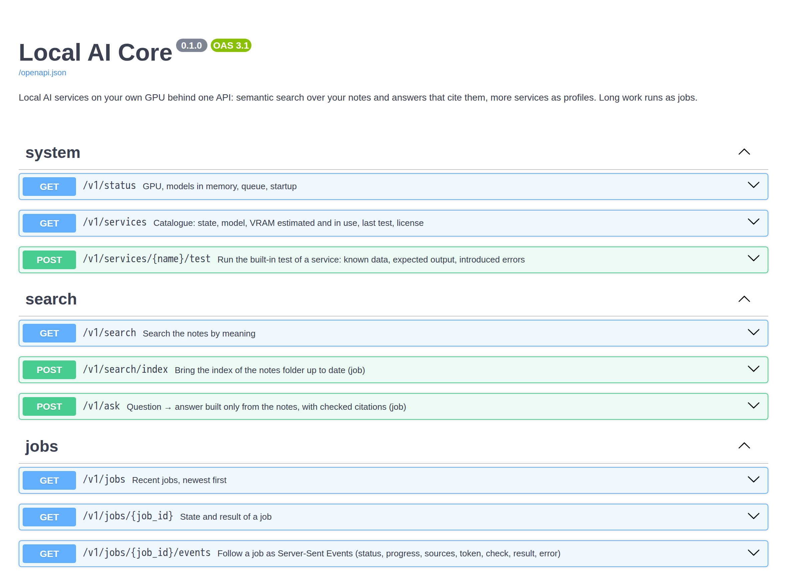

# API guide

[← back to the index](../README.md)

The full reference, generated from the code, is at **<http://localhost:8090/docs>** (and as JSON at
`/openapi.json`). This page shows the calls you will use most.



## Authentication

None by default, because the gateway listens on `127.0.0.1` only. With `LOCAL_AI_API_KEY` set, every `/v1`
call needs the key:

```bash
curl -H 'X-API-Key: your-key' http://localhost:8090/v1/status
# or: -H 'Authorization: Bearer your-key'
```

## Ask a question

```bash
curl -s -X POST 'http://localhost:8090/v1/ask?wait=true' \
  -H 'Content-Type: application/json' \
  -d '{"question": "How much did the bathroom repair cost?"}'
```

```json
{
  "id": "4f1c2a9be0d3", "kind": "ask", "status": "done",
  "result": {
    "answer": "The bathroom tap repair cost 180 euros, paid by bank transfer on 3 March [1].",
    "cited": [{"n": 1, "file": "house/repairs.md", "line": 5}],
    "invalid": [], "grounded": true, "sources": 6, "model": "qwen3.5:9b", "secs": 0.7,
    "excerpts": [{"score": 0.64, "file": "house/repairs.md", "line": 5, "text": "…"}]
  }
}
```

| Field | Meaning |
|---|---|
| `cited` | the excerpts the answer cites, in order |
| `invalid` | citation numbers that match no excerpt: if not empty, do not trust the answer |
| `grounded` | at least one valid citation and no invalid one |
| `excerpts` | what the model read |

Options: `n` (how many excerpts the model reads, default 6), `min` (minimum search score), `model`
(another Ollama model).

## Follow a job as it runs

Without `?wait=true` the call returns `202` and a job id at once:

```bash
job=$(curl -s -X POST http://localhost:8090/v1/ask -H 'Content-Type: application/json' \
      -d '{"question": "What do I do when the stove shows E5?"}' | python3 -c 'import json,sys; print(json.load(sys.stdin)["id"])')
curl -N http://localhost:8090/v1/jobs/$job/events
```

```text
id: 1
event: status
data: "running"

id: 2
event: sources
data: [{"score": 0.71, "file": "house/heating.md", …}]

id: 3
event: token
data: "When"
…
event: result
data: {"answer": "…", "cited": […]}
```

A client that loses the connection reconnects with `Last-Event-ID` (or `?after=N`) and receives only the
events it has not seen. `GET /v1/jobs/{id}` gives the state and the result at any time.

## Search

```bash
curl -s 'http://localhost:8090/v1/search?q=the+heating+shows+an+error+code&n=3'
```

Search by meaning: the query shares no words with the note it finds (`house/heating.md`, *E5 when the
exhaust pipe is blocked*). Each hit has `score`, `file`, `line`, `heads` (the headings above it) and `text`.

## Index the notes

```bash
curl -s -X POST 'http://localhost:8090/v1/search/index?wait=true' \
  -H 'Content-Type: application/json' -d '{"rebuild": false}'
```

Only the files that changed are read again. `"rebuild": true` reads everything.

## Convert a document

Needs the `docs` profile. A multipart upload; the result has the Markdown:

```bash
curl -s -X POST 'http://localhost:8090/v1/documents/convert?wait=true' \
  -F file=@my.pdf -F ocr=auto -F add_to_library=true
```

With `add_to_library=true` the Markdown is saved as `library/my.md` and indexed, so `/v1/ask` can answer
from it. `GET /v1/library` lists the library, `DELETE /v1/library/my.md` removes a document (and takes it
out of the index). Options and what happens to the files: [Documents](services/documents.md).

## Transcribe

Needs the `transcribe` profile (and `speakers` for who said what):

```bash
curl -s -X POST 'http://localhost:8090/v1/transcribe?wait=true' \
  -F file=@meeting.mp4 -F speakers=true -F language=auto
```

The result has `text`, `segments` (with `speaker`), `srt` and `vtt`. Add `-F expect="…"` to score the
transcript against the text it should say. Options: [Transcribe and speakers](services/transcribe.md).

## Images

Needs the `image` profile. Generate from JSON, upscale and cut out from a photo; the PNG is a file of the job:

```bash
curl -s -X POST 'http://localhost:8090/v1/images/generate?wait=true' -H 'Content-Type: application/json' \
  -d '{"prompt": "a lighthouse on a cliff at sunset, oil painting", "seed": 7}'
curl -s -o out.png http://localhost:8090/v1/jobs/<id>/file
curl -s -X POST 'http://localhost:8090/v1/images/cutout?wait=true' -F file=@photo.jpg
```

Options and limits: [Images](services/images.md).

## Handwriting and voice

```bash
curl -s -X POST 'http://localhost:8090/v1/handwriting?wait=true' -F file=@page.jpg
curl -s http://localhost:8090/v1/voices
curl -s -X POST 'http://localhost:8090/v1/speak?wait=true' -H 'Content-Type: application/json' \
  -d '{"text": "Hello, and welcome.", "format": "mp3"}'      # non-commercial use only: see Voice
```

[Handwriting](services/handwriting.md) · [Voice](services/voice.md) (`403` until its license is accepted).

## Status, services, tests

| Call | What it tells you |
|---|---|
| `GET /v1/status` | GPU name and VRAM, models in memory, queue, startup phase |
| `GET /v1/services` | every service: state, model, VRAM estimated and in use, license, last test |
| `POST /v1/services/{name}/test` | runs the built-in test of a service (job: follow its `check` events) |
| `GET /v1/jobs` | recent jobs, newest first |
| `GET /v1/jobs/{id}/file` | the file a job produced (images): it lives as long as the job |

## Errors

| Code | When |
|---|---|
| `401` | missing or wrong API key |
| `403` | the voice: its non-commercial license is not accepted (`XTTS_ACCEPT_CPML`) |
| `409` | the index is inconsistent: rebuild it |
| `413` | request body over `MAX_UPLOAD_MB` |
| `415` | a file type the service does not read |
| `502` | a job failed (`?wait=true`): the message says why |
| `503` | the worker for that service is not running |
