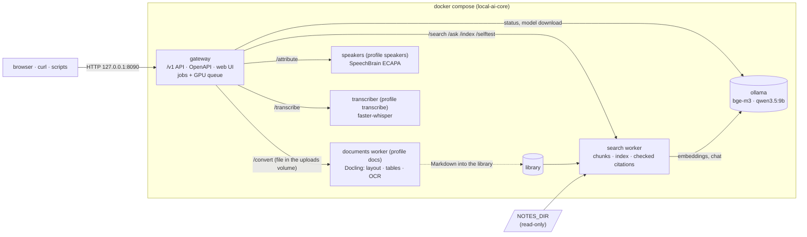
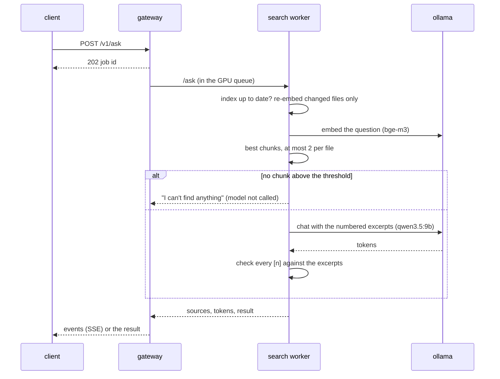

# Architecture

[← back to the index](../README.md)

One public process, the **gateway**, in front of small **workers** that never leave the compose network,
and **Ollama** running the models on the GPU.

## The pieces

| Piece | Where | Role |
|---|---|---|
| gateway | `gateway/` | the only listening port. Serves `/v1/…`, `/openapi.json`, `/docs` and the web page. Runs long work as jobs and keeps one GPU queue |
| search worker | `services/search/` | splits Markdown into chunks at headings, keeps the vector index, searches it, builds answers that cite only real excerpts |
| ollama | image `ollama/ollama` | runs the models; downloads them at the first start |

## Jobs and the GPU queue

Long work (an answer, an index rebuild, a built-in test) is a **job**: the `POST` returns `202` with a job
id, and the client follows it with `GET /v1/jobs/{id}` or the event stream
`GET /v1/jobs/{id}/events` (Server-Sent Events: `status`, `progress`, `sources`, `token`, `check`,
`result`, `error`). `?wait=true` turns any job into a plain blocking call.

GPU jobs wait in **one queue, one at a time**. On a 12 GB card a speech model, a voice model and an LLM
do not fit together; a queue is simpler and more honest than guessing what fits. The status bar of the
web page and `GET /v1/status` show what is running and how many jobs wait.

Ollama unloads a model after `IDLE_UNLOAD_MINUTES` without use (default 10), so VRAM goes back to the
system when the stack is idle.

## The worker contract

Every worker answers the same internal calls, so the gateway needs no list written by hand:

| Call | Answer |
|---|---|
| `GET /health` | alive |
| `GET /info` | the services it offers: model, VRAM estimate, license, profile |
| `POST /selftest` | its built-in test, as a stream of checks |
| service calls | here `/search`, `/ask`, `/index`, streaming NDJSON events |

`GET /v1/services` is the sum of every worker's `/info`, with the live state added (model present,
loaded, VRAM in use, last test).

## Data

| Volume | Content |
|---|---|
| `ollama` | the models |
| `index` | the vector index of the notes (rebuilt from the notes at any time) |
| `gateway-data` | the result of the last built-in test of each service |
| `uploads` | files being converted, deleted when their job ends |
| `library` | converted documents you chose to keep; searched with your notes as `library/…` |
| `documents-models` | Docling's models |
| `transcriber-models`, `speakers-models` | the Whisper and ECAPA models |
| `NOTES_DIR` | your notes, mounted read-only, never written |

Nothing is sent anywhere: no telemetry, and the models are downloaded from the Ollama registry only.

## How a question is answered

