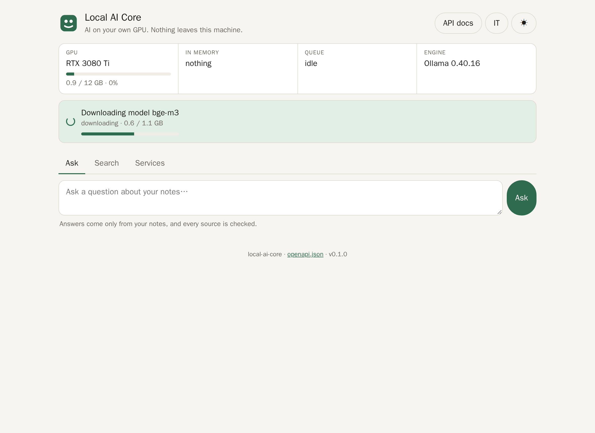
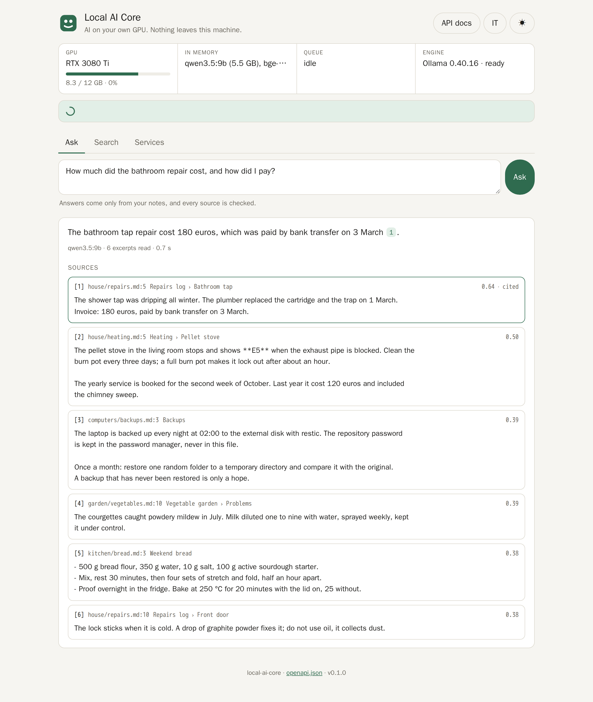

# Quick start: from zero to the first answer

[← back to the index](../README.md)

This page takes a machine with an NVIDIA GPU from nothing to a web page that answers questions about your
notes and cites the note each answer comes from. It takes about 15 minutes, and most of that time goes
into downloading the models (about 8 GB).

Every command here is run as written in the release test, so a step that fails here is a bug: please
[open an issue](https://github.com/manzolo/local-ai-core/issues).

## 1. What you need

| | Minimum | Notes |
|---|---|---|
| OS | Linux (x86_64) | Windows with WSL2 works with the same steps inside WSL |
| GPU | NVIDIA, 8 GB VRAM | 12 GB leaves room for the services added in later releases |
| Driver | NVIDIA driver installed on the host | `nvidia-smi` must work on the host |
| Docker | Docker Engine with the Compose plugin | `docker compose version` must answer |
| GPU in containers | [NVIDIA Container Toolkit](https://docs.nvidia.com/datacenter/cloud-native/container-toolkit/latest/install-guide.html) | lets containers use the GPU |
| Disk | 15 GB free | models 8 GB, images 1 GB, the rest is margin |

Nothing else is installed on the host: Python, the models and the web UI all live in containers.

## 2. Check that containers can see the GPU

```bash
docker run --rm --gpus all ubuntu:24.04 nvidia-smi
```

You should see the same table that `nvidia-smi` prints on the host, with your GPU's name. If you see
`could not select device driver "" with capabilities: [[gpu]]`, the NVIDIA Container Toolkit is missing
or Docker was not restarted after installing it: see [Troubleshooting](troubleshooting.md#the-gpu-is-not-visible-in-containers).

## 3. Get the project and start it

```bash
git clone https://github.com/manzolo/local-ai-core.git
cd local-ai-core
docker compose up -d
```

The first `up` builds two small images (about a minute) and starts three containers:

| Container | What it does |
|---|---|
| `gateway` | the API and the web page, on `http://localhost:8090` |
| `search` | search and answers over your notes |
| `ollama` | runs the models on the GPU |

The gateway then works on its own, and you can watch it in the web page or with
`curl -s http://localhost:8090/v1/status`:

1. it waits for Ollama;
2. it downloads the two models: `bge-m3` (1.2 GB, turns text into vectors) and `qwen3.5:9b` (6.6 GB,
   writes the answers);
3. it indexes the example notes in `examples/notes`.

## 4. Open the web page

Open **<http://localhost:8090>**. While the models download, a banner shows the progress:



When the banner disappears, the stack is ready. Type a question in **Ask**, for example
*How much did the bathroom repair cost, and how did I pay?*:



The answer cites `[1]`, and the first source is highlighted: `house/repairs.md`, line 5. If the model
cited an excerpt that does not exist, or none at all, a warning would say so.

## 5. The same thing from the command line

```bash
curl -s -X POST 'http://localhost:8090/v1/ask?wait=true' \
  -H 'Content-Type: application/json' \
  -d '{"question": "When is the stove serviced?"}'
```

The answer is in `result.answer`, its sources in `result.cited`. Without `?wait=true` the call returns
at once with a job id and the work goes on in the background: see the [API guide](api.md). Every endpoint
is described at **<http://localhost:8090/docs>**.

## 6. Search your own notes

Your notes are a folder of Markdown files (`.md`), for example an Obsidian vault. Point the stack at it:

```bash
cp .env.example .env
# in .env, set the absolute path of your folder:
#   NOTES_DIR=/path/to/your/notes
docker compose up -d
```

The folder is mounted read-only: nothing is ever written into it. The search container restarts with
the new folder; rebuild the index from **Search → Rebuild index**, or with
`curl -s -X POST 'http://localhost:8090/v1/search/index?wait=true' -H 'Content-Type: application/json' -d '{"rebuild": true}'`.
After that the index updates itself: each search re-reads only the files that changed.

## 7. Check that everything works

```bash
scripts/collaudo.sh
```

It runs the built-in tests of every service on your GPU (known data, expected answers, and errors put
in on purpose that must be caught) and asks one question end to end. The same test runs from the web
page: **Services → Run test**.

## 8. Everyday commands

| To… | Run |
|---|---|
| stop | `docker compose down` (models, index and settings stay in the volumes) |
| start again | `docker compose up -d` |
| see the logs | `docker compose logs -f` |
| update | `git pull && docker compose up -d --build` |
| remove everything, models too | `docker compose down -v` |

## Next

- Already running [ollama-docker](https://github.com/manzolo/ollama-docker)? Use its Ollama instead of a
  second one: [Join the local-ai-lab family](family.md).
- Open the gateway to your network, set an API key, change the models: [Configuration](configuration.md).
- How the pieces fit together: [Architecture](architecture.md).
