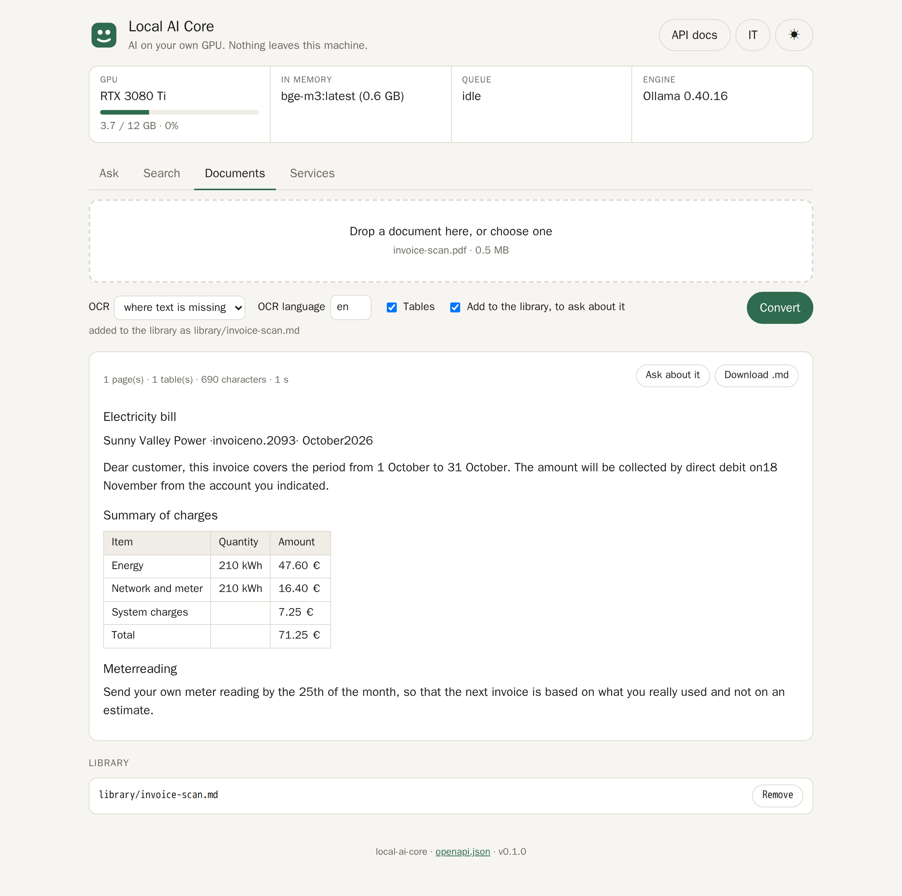
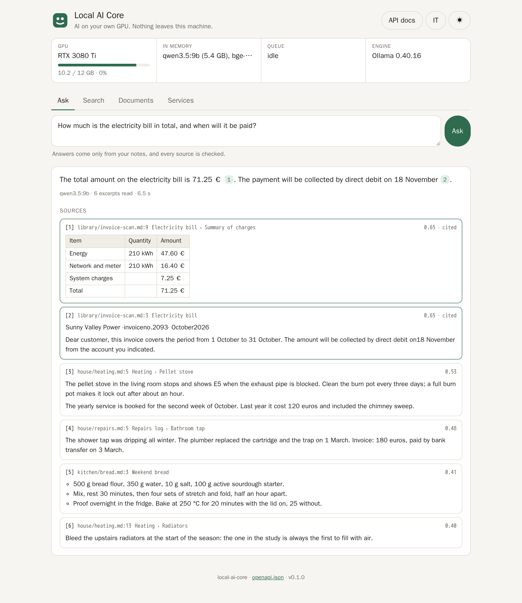

# Documents

[← back to the index](../../README.md)

Turns documents into Markdown with headings and tables, and, if you want, adds them to the **library**
so that [Ask](search-ask.md) can answer questions about them. Off by default: it lives in the compose
profile `docs` because its image is large (about 7 GB, mostly PyTorch with CUDA).

| | |
|---|---|
| Endpoint | `POST /v1/documents/convert`, `GET /v1/library`, `DELETE /v1/library/{name}` |
| Reads | PDF (with text, or scanned), PNG, JPEG, TIFF, BMP, WebP, DOCX, PPTX, XLSX, HTML |
| Engine | [Docling](https://github.com/docling-project/docling) 2.151.1: layout model, TableFormer for tables, RapidOCR for scans |
| VRAM | ~3 GB while it works; freed after `IDLE_UNLOAD_MINUTES` without work |
| Disk | image ~7 GB, models ~540 MB (downloaded on first use into the `documents-models` volume) |

## Start it

```bash
docker compose --profile docs up -d
```

The first conversion downloads the models (about half a gigabyte) and takes a little longer.



## From a PDF to an answer

```bash
# 1. convert a document and add it to the library (it is indexed right away)
curl -s -X POST 'http://localhost:8090/v1/documents/convert?wait=true' \
  -F file=@services/documents/documents_worker/selftest/invoice-scan.pdf \
  -F add_to_library=true

# 2. ask about it
curl -s -X POST 'http://localhost:8090/v1/ask?wait=true' -H 'Content-Type: application/json' \
  -d '{"question": "How much is the electricity bill in total, and when will it be paid?"}'
```

The answer cites `library/invoice-scan.md`, the Markdown made from a crooked, noisy scan:



## Options

| Field | Default | Meaning |
|---|---|---|
| `file` | — | the document (up to `MAX_UPLOAD_MB`) |
| `ocr` | `auto` | `auto`: OCR only where a page has no text · `force`: OCR every page (a PDF whose text is broken) · `off`: never |
| `lang` | `en` | OCR language, one at a time |
| `tables` | `true` | recognise table structure |
| `add_to_library` | `false` | save the Markdown as `library/<name>.md` and index it |

The result holds `markdown`, `pages`, `tables`, `chars`, `secs`, and, with `add_to_library`, the library
path and the index update. Converting a file with the same name again replaces its library copy.

## What happens to your files

- the upload is written to the `uploads` volume and **deleted when its job ends**, successful or not;
- the Markdown goes into the `library` volume only if you ask (`add_to_library`), and `DELETE
  /v1/library/{name}` removes it from the library and from the index;
- before a conversion, if the GPU has less free VRAM than Docling needs, the gateway asks Ollama to free
  its models now instead of waiting for their idle timeout (the job's `unload` event says so).

## Built-in test

On an invented electricity bill ([`examples/documents/invoice.html`](../../examples/documents/invoice.html)),
printed to PDF and "scanned" (turned, grey, noisy) by `scripts/make-fixtures.sh`:

| Check | Expected |
|---|---|
| the PDF with text | title, the table, the amounts 47.60 and 71.25, "direct debit" |
| **introduced error**: a figure changed in the expected text (71.52) | the comparison reports it missing |
| the scan, with OCR | the amounts and the table read back |
| **introduced error**: the scan with OCR off | refused: "no text extracted", nothing invented |
| **introduced error**: a broken PDF | an error message, no crash |
