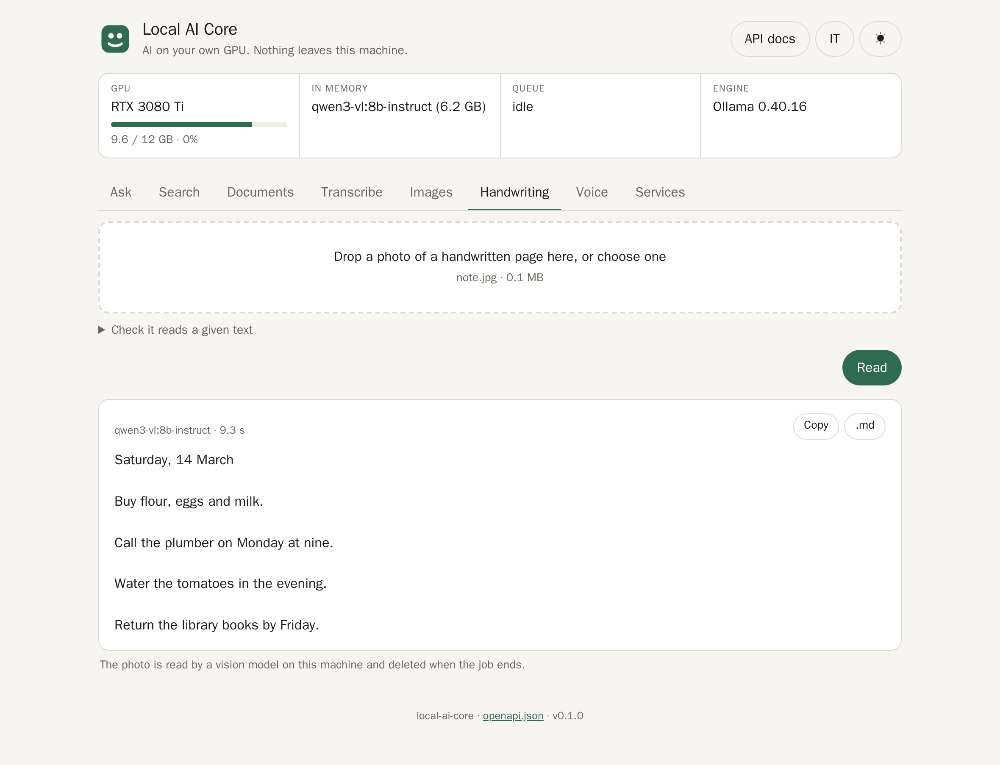

# Handwriting

[← back to the index](../../README.md)

Photos of handwritten notes become text, read by a vision model on Ollama: the photo never leaves the
machine and is deleted when its job ends. Profile `handwriting`, off by default.

| | |
|---|---|
| Endpoint | `POST /v1/handwriting` |
| Model | [qwen3-vl:8b-instruct](https://ollama.com/library/qwen3-vl) on Ollama (Apache-2.0), ~6 GB, downloaded on first use |
| VRAM | ~7 GB while reading; Ollama frees it after `IDLE_UNLOAD_MINUTES` |
| Reads | PNG, JPEG, WebP, BMP, TIFF; photos are straightened (EXIF) and shrunk to 2000 px a side |

## Start it

```bash
docker compose --profile handwriting up -d
```

With the [family override](../family.md) the worker reads with the family's Ollama. The first page
downloads the model.



## From the command line

```bash
curl -s -X POST 'http://localhost:8090/v1/handwriting?wait=true' -F file=@page.jpg
```

The result holds `text` (simple Markdown, line breaks kept), `empty` (true when the page has no writing),
`model` and `secs`. Add `-F expect="…"` to score the reading against the text the page should say
(`score` 0–1, `matches` from 0.8).

## How it reads

The model is asked to transcribe faithfully, in the language of the page, without summarising,
correcting or translating; an unreadable word becomes `[illegible]`, a guess goes in `[? ]`. A page with no
writing must come back as `[no text]`, and the service reports it as `empty` instead of inventing text.
The `-instruct` model is used on purpose: the "thinking" variant of qwen3-vl can reason on a real page
for ever without writing anything.

## Built-in test

On an invented note written in the [Caveat](https://fonts.google.com/specimen/Caveat) handwriting font
(SIL Open Font License) on lined paper, made by `scripts/make-handwriting-fixtures.sh`:

| Check | Expected |
|---|---|
| the note | read with similarity ≥ 0.8 |
| **introduced error**: a different expected text | not matching |
| **introduced error**: a blank page | reported empty, nothing invented |
