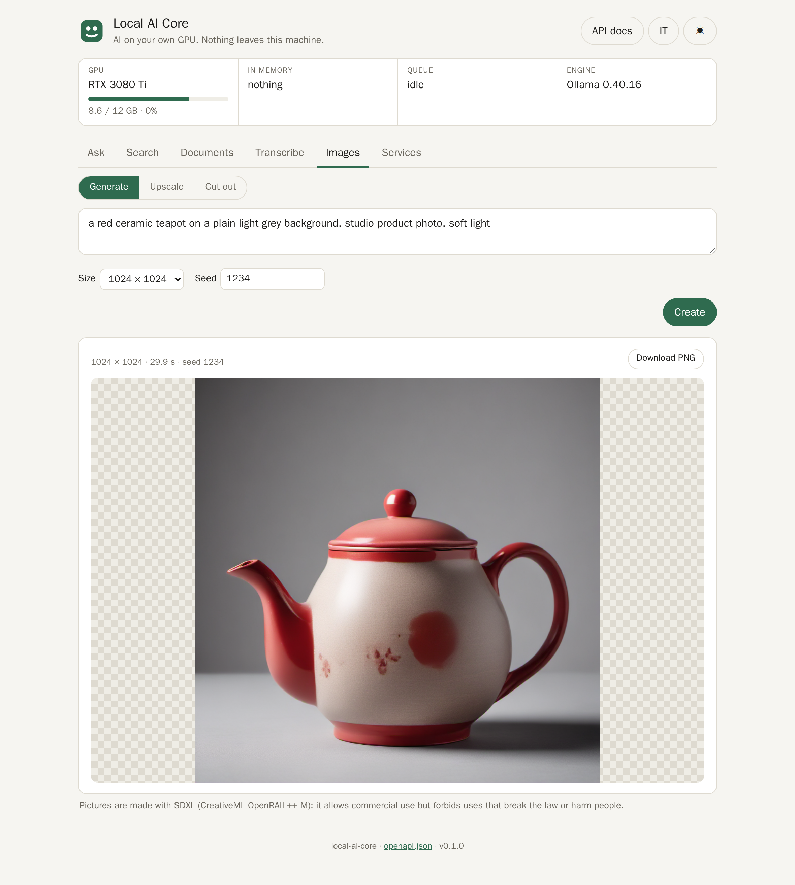
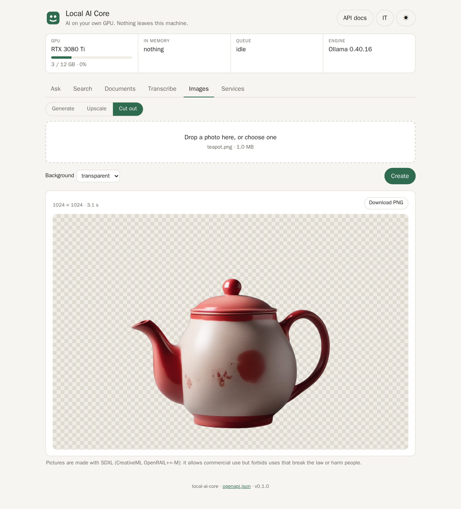

# Images

[← back to the index](../../README.md)

Pictures from a description, photos upscaled ×2 or ×4, subjects cut out on a transparent background, with
[ComfyUI](https://github.com/comfyanonymous/ComfyUI) on the GPU. Profile `image`, off by default.

| | |
|---|---|
| Endpoints | `POST /v1/images/generate`, `POST /v1/images/upscale`, `POST /v1/images/cutout`; the PNG at `GET /v1/jobs/{id}/file` |
| Generate | SDXL base 1.0 with the SDXL-Lightning LoRA: 4 steps, about 1.5 s for 1024×1024 once loaded |
| Upscale | RealESRGAN x4plus (×2 = ×4, then halved with lanczos) |
| Cut out | BiRefNet; transparent, or on white, black or any `#rrggbb` |
| VRAM | ~8 GB while working; all of it back when idle (ComfyUI is stopped) |
| Disk | image ~10 GB (PyTorch shared with `docs` and `speakers`), models ~7.4 GB on first use |

## Start it

```bash
docker compose --profile image up -d
```

The first job downloads the models from their official sources (about 7.4 GB) and checks each against its
sha256: a file that does not match is discarded, never loaded.





## From the command line

```bash
# generate: JSON in, a job out; ?wait=true waits for it
curl -s -X POST 'http://localhost:8090/v1/images/generate?wait=true' -H 'Content-Type: application/json' \
  -d '{"prompt": "a lighthouse on a cliff at sunset, oil painting", "width": 1216, "height": 832, "seed": 7}'
# → {"result": {"width": 1216, "height": 832, "seed": 7, "secs": 1.6, "file": "/v1/jobs/<id>/file"}, …}
curl -s -o lighthouse.png http://localhost:8090/v1/jobs/<id>/file

# upscale and cut out: a photo in
curl -s -X POST 'http://localhost:8090/v1/images/upscale?wait=true' -F file=@photo.jpg -F scale=4
curl -s -X POST 'http://localhost:8090/v1/images/cutout?wait=true' -F file=@photo.jpg -F background=white
```

| Field | Default | Meaning |
|---|---|---|
| `prompt` | — | what the picture shows |
| `negative` | `blurry, deformed, low quality, text, watermark` | what to avoid |
| `width`, `height` | 1024 | 512–1536, multiples of 8 (SDXL likes about one megapixel: 1024×1024, 1216×832, 832×1216) |
| `steps` | 4 | 1–8; the Lightning LoRA is made for 4 |
| `seed` | random | the same seed and prompt give the same picture |
| `scale` | 4 | upscale: 2 or 4 |
| `background` | transparent | cut out: empty, `white`, `black` or `#rrggbb` |

The PNG lives as long as its job: the gateway keeps the last 200 jobs in memory, and a restart forgets
them. Download what you want to keep. Uploaded photos are deleted when their job ends.

## Another checkpoint

`IMAGE_CHECKPOINT` in `.env` names another SDXL checkpoint, for example a fine-tune you prefer. Put its
`.safetensors` file in the `image-models` volume, under `checkpoints/`, and **check its license**: many
community checkpoints have their own terms. The Lightning LoRA stays.

## The GPU is shared

ComfyUI with SDXL takes about 8 GB of a 12 GB card, so it cannot sit next to the LLM. Before every GPU job
the gateway looks at the free VRAM and, if it is not enough, makes room: it asks Ollama to free its models
and the other workers to unload. A worker that unloads restarts its container, the only way to give back
all of its memory; the gateway waits for it if it is needed next. The job's `unload` events say what was
freed.

## License and use

SDXL base 1.0 and the Lightning LoRA are under the **CreativeML OpenRAIL++-M** license: commercial use is
allowed, but the license forbids some uses (breaking the law, harming people, misleading with generated
content, and the others listed in it). The web page, `/v1/services` and [Licenses](../licenses.md) say so.
RealESRGAN is BSD-3-Clause, BiRefNet MIT. ComfyUI is GPL-3.0: it runs unmodified as a separate program.

## Built-in test

| Check | Expected |
|---|---|
| generate 512×512 with seed 42 | a 512×512 PNG with real content (not a flat picture) |
| **introduced error**: a checkpoint that does not exist | refused by ComfyUI, with the reason |
| upscale a synthetic 64×64 photo ×4 | 256×256 |
| cut out the same photo (a red disk on blue) | the disk opaque, the corner transparent |
| **introduced error**: the same cut-out without inverting the mask | the check fails: the subject would vanish |
