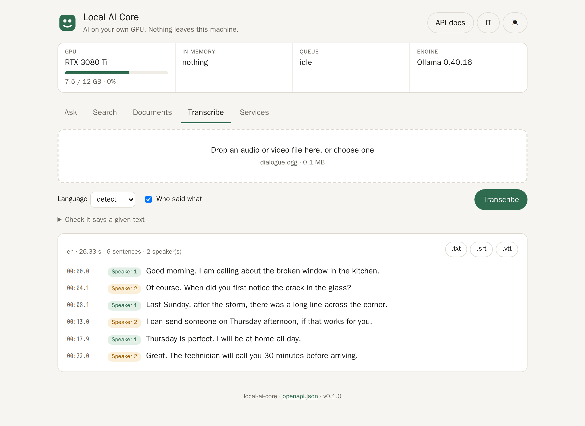

# Transcribe and speakers

[← back to the index](../../README.md)

Audio and video become text and subtitles; optionally each sentence gets its speaker, and the transcript
can be checked against the text the audio should say. Two workers, each in its own compose profile:

| | Transcribe | Speakers (who said what) |
|---|---|---|
| Profile | `transcribe` | `speakers` |
| Engine | [faster-whisper](https://github.com/SYSTRAN/faster-whisper) 1.2.1, model `large-v3` | [SpeechBrain](https://github.com/speechbrain/speechbrain) 1.1.2, ECAPA voice fingerprints |
| VRAM | ~5 GB while it works | ~1 GB while it works |
| Disk | image ~3.4 GB, model ~3 GB | image ~6.6 GB (PyTorch, shared with documents), model ~90 MB |
| License | MIT (code and model) | Apache-2.0 (code and model) |

Both download their model on first use and free the GPU after `IDLE_UNLOAD_MINUTES` without work.

## Start them

```bash
docker compose --profile transcribe --profile speakers up -d
```

`transcribe` alone is enough for text and subtitles; `speakers` adds who said what.



## From the command line

```bash
curl -s -X POST 'http://localhost:8090/v1/transcribe?wait=true' \
  -F file=@services/speakers/speakers_worker/selftest/dialogue.ogg -F speakers=true
```

| Field | Default | Meaning |
|---|---|---|
| `file` | — | audio or video: WAV, MP3, OGG/Opus, M4A, FLAC, AAC, WMA, WebM, MP4, MKV, MOV, AVI |
| `language` | `auto` | the spoken language (`en`, `it`, …) or `auto` to detect it |
| `speakers` | `false` | split by speaker (needs the `speakers` profile, else `503`) |
| `num_speakers` | `0` | the exact number of speakers, when you know it; `0` finds out |
| `expect` | — | the text the audio should say: the result gets `score` (0–1) and `matches` (score ≥ 0.85) |

The result holds `language`, `duration`, `segments` (`start`, `end`, `text`, and `speaker` when asked),
`text`, `srt` and `vtt`. With speakers, the subtitles start each line with `Speaker N:` and the text has
one paragraph per change of speaker. Without `?wait=true` the job reports progress in seconds of audio.

## Checking that a voice says what it should

`expect` compares the transcript with the text it should say, word by word (case and punctuation do not
count). It is how you catch a synthetic voice that skipped or garbled a line: below 0.85, `matches` is
`false` and the web page says so in red.

## How speakers are told apart

Each sentence of at least 0.6 s gets a voice fingerprint (ECAPA over 3 s windows every 1.5 s, averaged).
Without `num_speakers`, two sentences belong to the same speaker when their cosine distance is under
0.55; with it, the sentences are split into exactly that many groups. Shorter sentences take the speaker
of the nearest sentence in time. Speakers are numbered in the order they first speak.

## Built-in tests

The test audio is synthetic, made by `scripts/make-audio-fixtures.sh` with two
[Piper](https://github.com/OHF-Voice/piper1-gpl) voices trained on public-domain recordings (LJ Speech and
LibriVox). Piper itself runs only in that generator, never in a service.

| Check | Expected |
|---|---|
| a known sentence | transcribed with similarity ≥ 0.85, language `en`, with times |
| **introduced error**: a different expected text | reported as not matching |
| **introduced error**: a file that is not audio | an error message |
| a dialogue, two voices alternating six times | two speakers found unaided, sequence 1 2 1 2 1 2; the same with `num_speakers=2` |
| **introduced error**: three sentences of one voice | one speaker, not two |
| **introduced error**: no sentences | refused |
