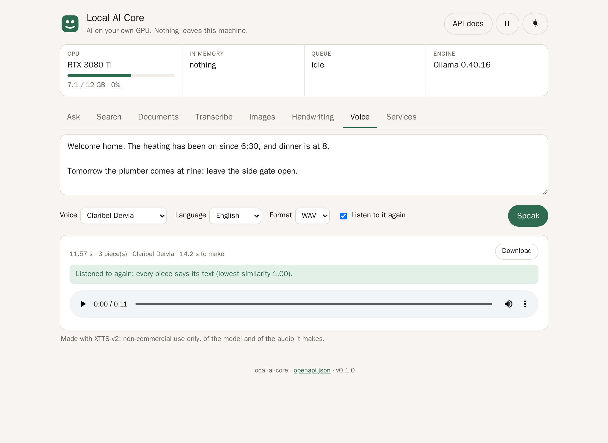

# Voice

[← back to the index](../../README.md)

> [!IMPORTANT]
> **Non-commercial use only.** XTTS-v2 is under the
> [Coqui Public Model License](https://huggingface.co/coqui/XTTS-v2/blob/main/LICENSE.txt), which allows only non-commercial use of the
> model **and of the audio it makes**. The voice service stays off until you accept that license
> yourself: `XTTS_ACCEPT_CPML=yes` in `.env`. Nobody accepts it for you.

Text becomes speech with [XTTS-v2](https://huggingface.co/coqui/XTTS-v2) and its built-in voices. Long
texts are read in short pieces, numbers are spelled out, and each piece is listened to again by the
transcriber and redone if it does not say its text. Profile `voice`, off by default.

| | |
|---|---|
| Endpoints | `POST /v1/speak` (the audio at `GET /v1/jobs/{id}/file`), `GET /v1/voices` |
| Model | XTTS-v2 through [coqui-tts](https://github.com/idiap/coqui-ai-TTS) 0.27.5 (code MPL-2.0), ~1.9 GB, downloaded on first use |
| Voices | the 58 built-in voices of the model; no cloning from a sample, so nobody's voice can be copied |
| Languages | en, it, es, fr, de, pt, pl, tr, ru, nl, cs, ar, zh-cn, ja, hu, ko, hi |
| Output | WAV 24 kHz mono, MP3 or OGG (Opus) |
| VRAM | ~3 GB; ~8 GB while listening again (the transcriber runs too) |

## Start it

```bash
# in .env, after reading https://huggingface.co/coqui/XTTS-v2/blob/main/LICENSE.txt:
#   XTTS_ACCEPT_CPML=yes
docker compose --profile voice --profile transcribe up -d
```

`transcribe` is optional but recommended: without it the audio is made but not listened to again, and
the result says so.



## From the command line

```bash
curl -s -X POST 'http://localhost:8090/v1/speak?wait=true' -H 'Content-Type: application/json' \
  -d '{"text": "Welcome home. The heating is on, and dinner is at 7:30.", "voice": "Claribel Dervla",
       "language": "en", "format": "mp3"}'
curl -s -o speech.mp3 http://localhost:8090/v1/jobs/<id>/file
```

The result holds `duration`, `pieces`, `voice`, and `verify`: whether it was listened to again, the lowest
similarity, how many pieces were redone, and the ones that still do not say their text (`below`).

## How long texts stay right

| Rule | Why |
|---|---|
| sentences without their final full stop, no quotes | XTTS says "dot" for a final full stop and stumbles on quotes |
| at most ~220 characters per piece, cut at commas | a long sentence drifts and starts to babble |
| numbers, times, years and decimals spelled out (English and Italian) | digits come out wrong; codes with a leading zero are read digit by digit |
| a short pause inside a sentence, longer between sentences, longer still between paragraphs | it sounds read, not glued |
| each piece listened to again; under similarity 0.85 it is redone, up to 3 times, keeping the best | another try usually gets it right |

## The license notice travels with the audio

The license asks that whoever gets the model's output from you also gets its terms, or the address of
them. So every file carries a notice with that address: in a WAV it is the comment of the `LIST/INFO`
chunk, in MP3 and OGG the `comment` tag. Keep it when you edit the audio, and mention it where you publish
it. (The address written in the license itself, `coqui.ai/cpml.txt`, no longer works since Coqui closed:
the terms are kept next to the model, at the address above.)

## Built-in test

| Check | Expected |
|---|---|
| the license | accepted (otherwise every other check is skipped and the service is off) |
| the built-in voices | 58, the default one among them |
| numbers spelled out | "Meet me at 10:30 on 3 May 2027" → "… ten thirty on three May twenty twenty-seven" |
| a known sentence | a 24 kHz WAV of plausible length and loudness |
| the license notice | inside the file, with the address of the terms |
| listened to again (when the transcriber runs) | similarity ≥ 0.85 |
| **introduced error**: a different expected text | not matching |
| **introduced error**: a text with no words | refused |
