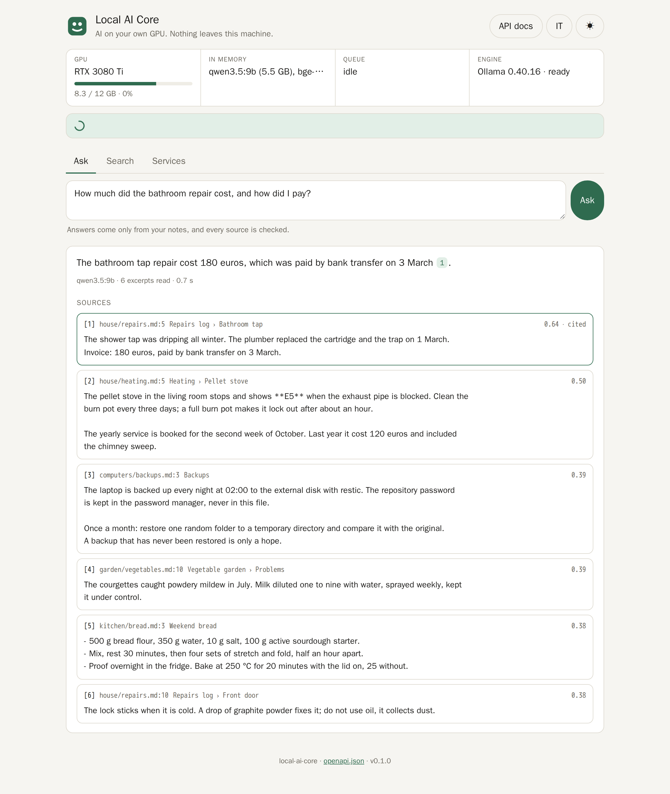
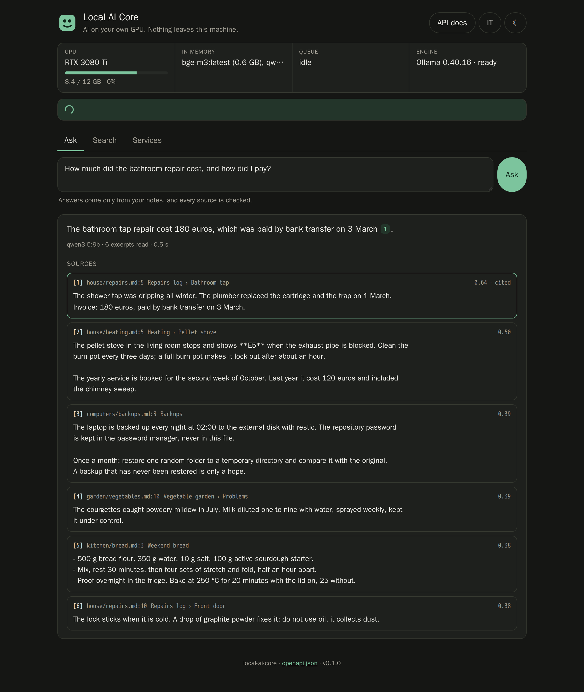
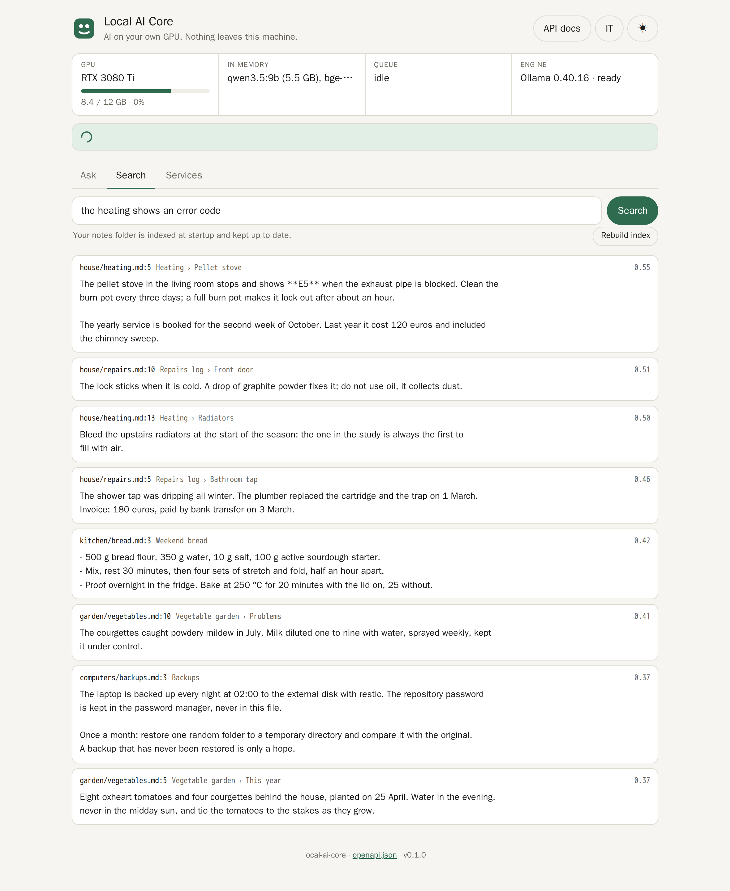
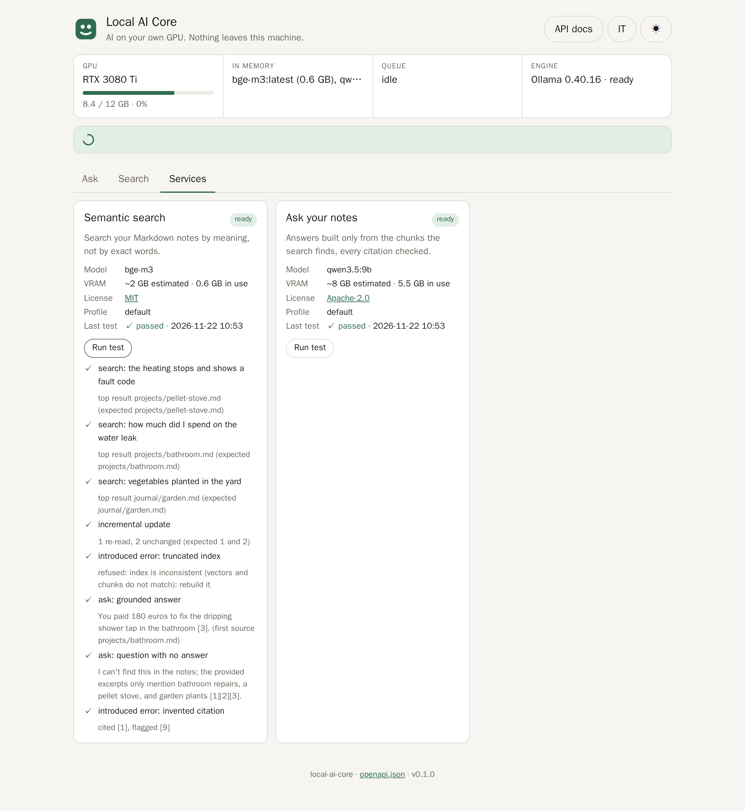
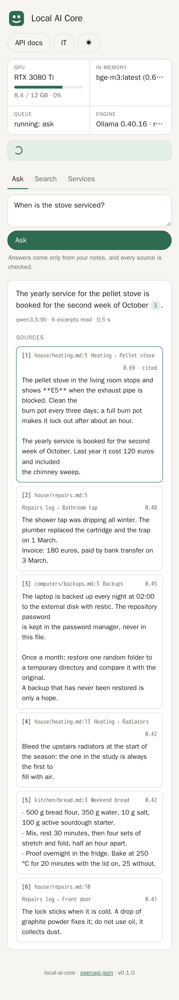

# Web interface

[← back to the index](../README.md)

One page at **<http://localhost:8090>**, served by the gateway itself: no CDN, no fonts or scripts from
elsewhere, so it works offline. It uses only the public `/v1` API, the same one documented at `/docs`.

| Light | Dark |
|---|---|
|  |  |

## What is on the page

- **Status bar**: the GPU and its VRAM, the models Ollama holds in memory right now, the job queue, the
  engine. It refreshes every 3 seconds.
- **Ask**: a question about your notes. The answer streams as it is written; each `[n]` links to its
  excerpt below, and the cited excerpts are highlighted. A citation that matches no excerpt shows in red
  with a warning.
- **Search**: search by meaning, with the score and the headings above each hit. **Rebuild index**
  reads every file again.
- **Services**: each service with its model, VRAM, license and last test. **Run test** runs its built-in
  test and shows every check as it completes.

## Language, theme, phone

The page follows the browser's language (English or Italian) and the system theme; the two buttons at
the top right switch them, and the choice is remembered in this browser. It works at phone width:

The page can also be opened on a given tab, theme and language: `/?tab=search&theme=dark&lang=it`.

## With an API key

When `LOCAL_AI_API_KEY` is set, the page asks for the key once and keeps it in this browser
(`localStorage`).
